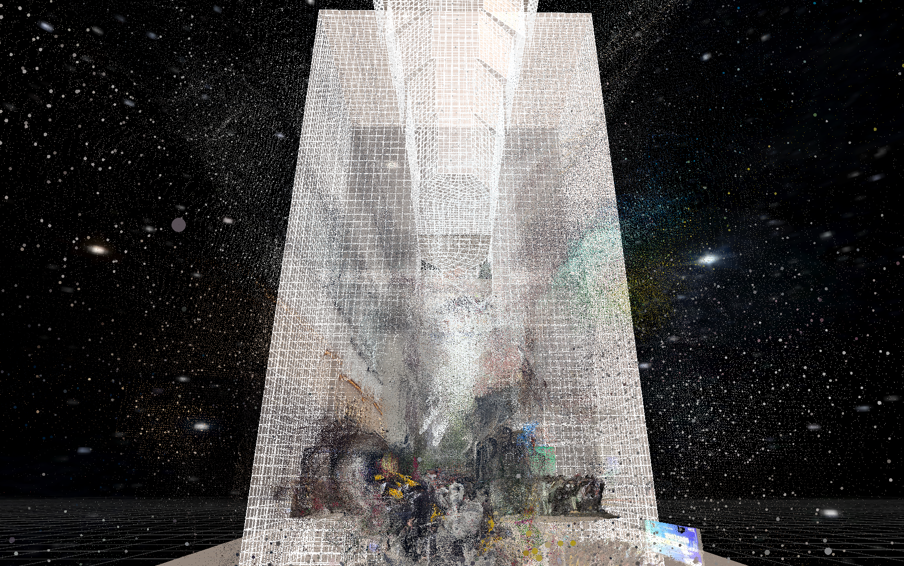
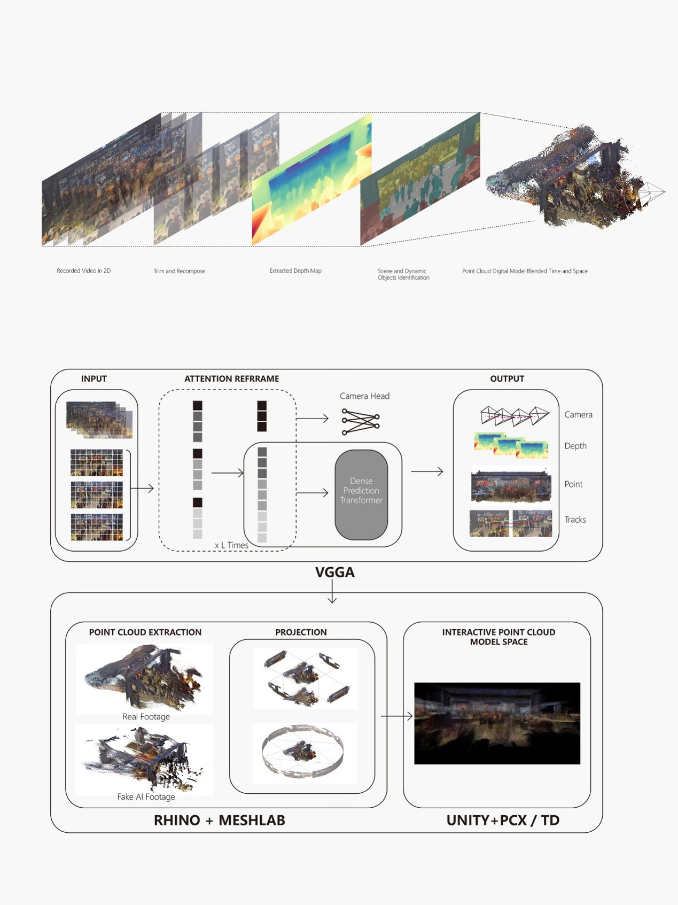
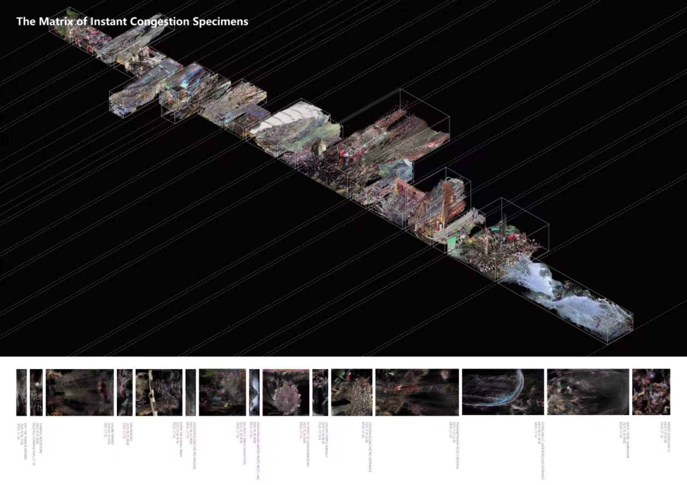
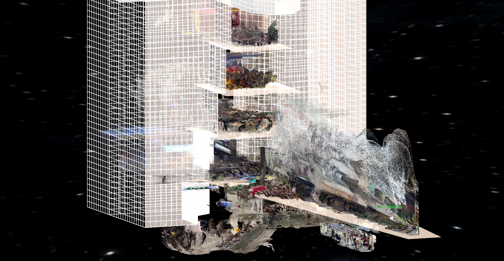
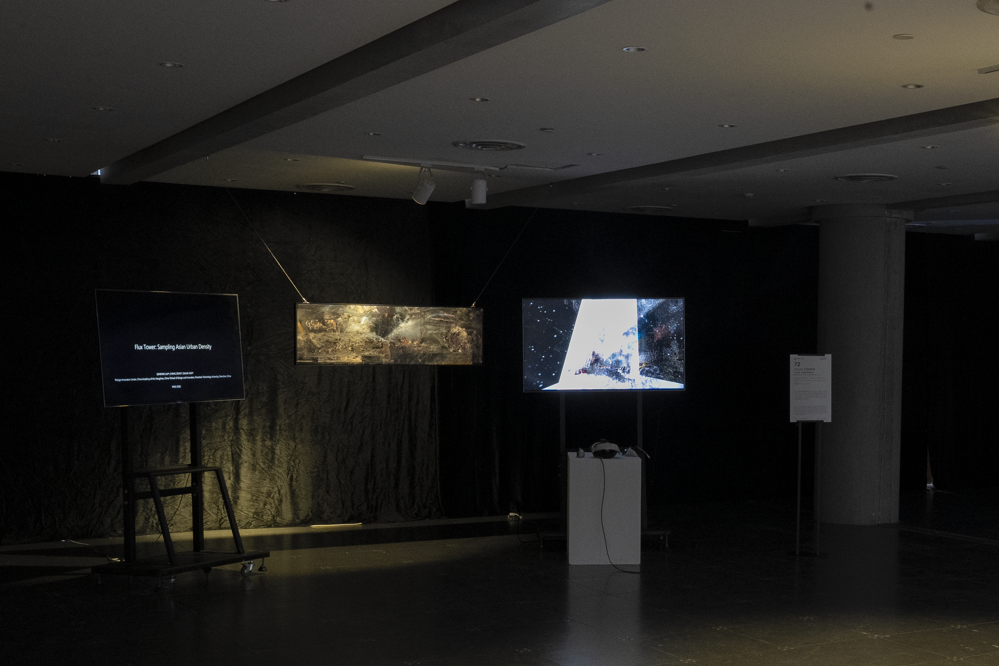

Artistic Research & VR Installation | 2026

*An immersive point-cloud journey through Asian urban density*

What would an archive of a city in motion preserve? Flux Tower begins with places people pass through briefly: subway platforms, markets, and delivery waiting areas. Here, crowds gather and disperse, and much of the work that keeps the city running is visible only in passing. The installation reconstructs selected moments from video as point clouds and arranges them inside a virtual tower, where visitors can move through them at their own pace.

## From footage to urban specimens

The team recorded footage on site and used Visual Geometry Grounded Transformer (VGGT) to reconstruct selected clips as point clouds. The raw reconstructions often yielded fragmented geometry and inconsistent orientations. In Rhino and MeshLab, the team selected, cropped, and manually aligned the fragments in a common coordinate system. Tested viewpoints and time windows guided the selection of what the project calls *instant congestion specimens*: short slices of urban activity that retain traces of movement, proximity, and waiting.

The specimens become an archive of the city's *cache*: places that briefly hold concentrations of activity before dispersing them. Speckles, gaps, and partial silhouettes remain visible in the finished scenes. Their incompleteness lets one space remain legible through another when the fragments overlap.

## Reading the city through movement

In Unity, the specimens are layered inside a transparent tower inspired by the alternating bright and dark floors of a traditional Chinese octagonal pagoda. The bright floors hold scenes of public activity, such as commuters and shoppers. The dark floors draw attention to the labour and infrastructure behind those scenes, including delivery and overnight cleaning.

Visitors move horizontally through the clusters and vertically between floors. Near and far fragments shift against one another as the viewpoint changes, so new spatial relationships become visible through proximity and parallax. The tower brings moments recorded in different places and at different times into a single space that visitors can explore from several perspectives.

## Exhibition

*Exhibition view, VINCI 2026.*

- Collaborated with Qinrong Liu.